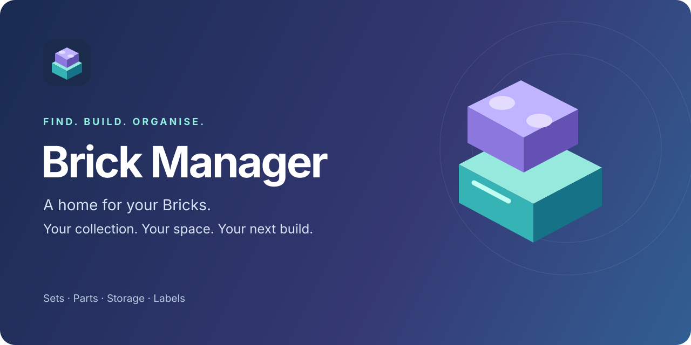

# Brick Manager

[](https://github.com/Kornhaas/Brick_Manager/actions/workflows/docker-image.yml)
[](https://github.com/Kornhaas/Brick_Manager/actions/workflows/python-app.yml)
[Dokumentation](docs/README.md) · [Benutzeranleitung](docs/guides/user-guide.md) · [Docker-Betrieb](docs/guides/docker.md)

Brick Manager ist eine Flask-Anwendung zur Verwaltung einer Klemmbaustein-Sammlung: Sets, Teile, Minifiguren, Fehlteile, Lagerorte und Etiketten werden lokal in SQLite verwaltet. Rebrickable und Brickognize sind optionale externe Integrationen.

Die vollständige, gepflegte Dokumentation beginnt unter [docs/README.md](docs/README.md). Diese Datei bleibt bewusst im Repository-Root, weil Poetry sie als Paketbeschreibung verwendet.

## Schnellstart

Voraussetzungen: Python 3.12, Poetry und SQLite.

```powershell
Copy-Item .env.example .env
poetry install
poetry run flask --app brick_manager/app.py run
```

Vor dem Start in `.env` die gewünschte Datenbank ausdrücklich konfigurieren;
ein App-Start kann Migrationen und geplante Jobs auslösen. Für einen Probelauf
eine neue, separate Datenbank verwenden. Details und die Produktivgrenze stehen
in der [Konfiguration](docs/reference/configuration.md#produktivdatenbank).
Die Anwendung ist danach unter `http://127.0.0.1:5000` erreichbar. Vor einem echten Rebrickable-Abgleich und vor dem Einsatz der Desktop-API müssen die Zugangsdaten in `.env` gesetzt werden.

## Einstiegspunkte

- [Referenzarchitektur](docs/architecture/reference-architecture.md)
- [Konfiguration und Sicherheit](docs/reference/configuration.md)
- [Entwicklung](docs/guides/development.md)
- [Tests](docs/guides/testing.md)
- [Docker-Betrieb](docs/guides/docker.md)
- [Datenmodell und Migrationen](docs/reference/database-schema.md)

## Dokumentationsregeln

`brick_manager/models.py`, versionierte Migrationen und ausführbare Tests sind die maßgeblichen Quellen für Persistenz und Verhalten. Änderungen an Routen, externen Verträgen, Konfiguration oder Datenmodell müssen die jeweils verlinkte Referenzdokumentation im selben Change aktualisieren.
