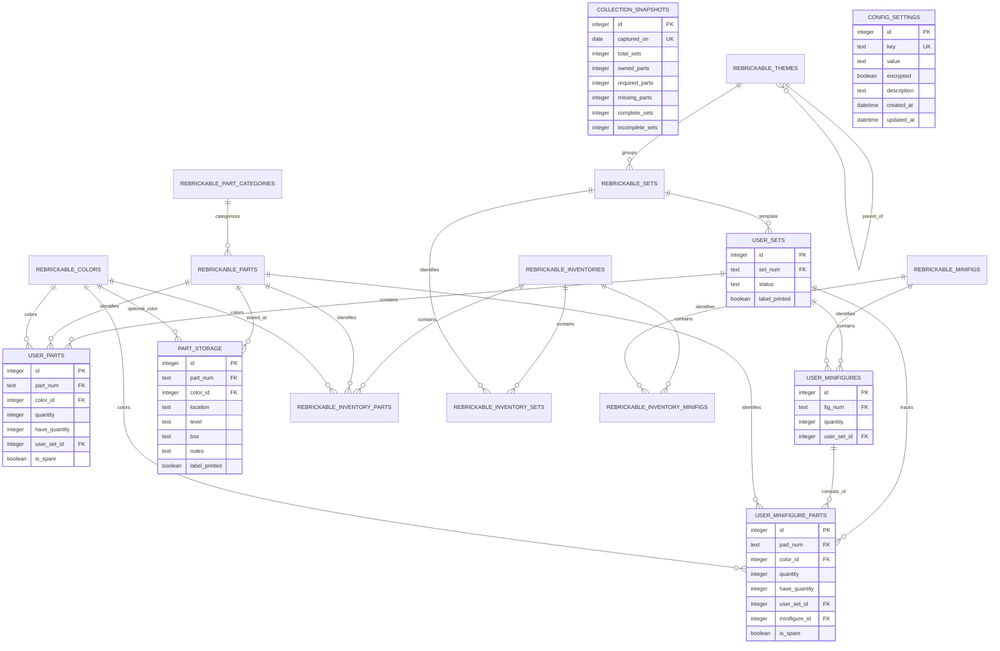

# Brick Manager Database Schema

This document describes the schema declared in `brick_manager/models.py`. The model file and versioned migrations, when present, are authoritative. `db.create_all()` creates missing tables for a new database but does not upgrade existing tables.

## Entity overview

The catalog tables omitted from the field-level diagram for readability are listed below.

## User-owned tables

| Table | Purpose | Important behavior |
| --- | --- | --- |
| `user_sets` | One physical copy of an owned set | Multiple rows may reference the same `set_num`; this represents multiple copies. Child parts and minifigures are deleted with the copy. |
| `user_parts` | Required and owned part quantities for one set copy | Part, color, quantity, owned quantity, and spare status are tracked separately. |
| `user_minifigures` | Minifigure instances belonging to a set copy | References a Rebrickable minifigure and its owning `user_set`. |
| `user_minifigure_parts` | Required and owned parts belonging to a minifigure | References both the owning set and the specific `user_minifigure`. |
| `part_storage` | Physical locations for catalog parts | A part may have several rows. Color is optional; notes and label state are per row. |
| `config_settings` | Application settings and encrypted tokens | `key` is unique. `to_dict()` masks values marked as encrypted. |
| `collection_snapshots` | Daily aggregate history for dashboard trends | One row per date; same-day refreshes update the existing snapshot. No collection detail rows are duplicated. |

### Set statuses

Allowed values are defined by `USER_SET_STATUSES` in `brick_manager/models.py`:

| Value | Meaning |
| --- | --- |
| `unknown` | Contents have not been assessed. |
| `konvolut` | Set belongs to a mixed lot. |
| `assembled` | Set is built; its parts are not counted as loose inventory. |
| `sealed` | Set remains in original packaging; all contents are owned but not loose inventory. |
| `missingparts` | Known to be incomplete. |
| `complete` | All regular and spare contents are present. |
| `completenospareparts` | Complete except for spare parts. |

## Rebrickable catalog tables

| Table | Primary key | Purpose |
| --- | --- | --- |
| `rebrickable_part_categories` | `id` | Part category names. |
| `rebrickable_colors` | `id` | Color metadata, RGB values, transparency, and statistics. |
| `rebrickable_parts` | `part_num` | Canonical parts and their category. |
| `rebrickable_part_relationships` | `rel_type`, `child_part_num`, `parent_part_num` | Parent/child and variant relationships. |
| `rebrickable_elements` | `element_id` | Part/color element mapping. |
| `rebrickable_themes` | `id` | Hierarchical set themes. |
| `rebrickable_sets` | `set_num` | Canonical set metadata. |
| `rebrickable_minifigs` | `fig_num` | Canonical minifigure metadata. |
| `rebrickable_inventories` | `id` | Inventory version and its external set/minifigure number. |
| `rebrickable_inventory_parts` | `inventory_id`, `part_num`, `color_id`, `is_spare` | Parts in an inventory. |
| `rebrickable_inventory_sets` | `inventory_id`, `set_num` | Nested sets in an inventory. |
| `rebrickable_inventory_minifigs` | `inventory_id`, `fig_num` | Minifigures in an inventory. |

## Data ownership rules

- Catalog refreshes may replace Rebrickable reference data but must preserve user-owned rows, quantities, locations, notes, statuses, and label flags.
- A repeated `set_num` in `user_sets` is valid and means the collection contains multiple physical copies.
- `quantity`, `have_quantity`, `color_id`, and `is_spare` must not be collapsed during imports or reconciliation.
- Existing databases require an explicit migration when columns or constraints change. Migration files belong under `brick_manager/migrations/` and are intended to be committed.
