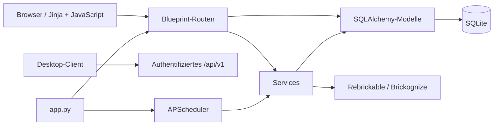

# Architektur

Brick Manager ist eine Flask-Anwendung mit SQLite/SQLAlchemy-Persistenz. Der
Code ist nach HTTP-Routen, wiederverwendbaren Services und Datenmodellen
gegliedert.

`app.py` setzt die Anwendung zusammen: Konfiguration, Datenbank, Migrations-
Extension, Logging, Blueprints und zeitgesteuerte Aufgaben. Die `routes/`
nehmen HTTP-Anfragen entgegen und rendern Templates bzw. liefern JSON.
`services/` enthält API-, Synchronisierungs-, Datei-, Cache- und Label-Logik.
`models.py` ist die verbindliche Definition der SQLite-Tabellen und Beziehungen.

Die Rebrickable-Tabellen sind Katalogdaten; `user_*`, `part_storage` und
`config_settings` enthalten nutzereigenen Zustand. Eine Katalogaktualisierung
darf diesen Zustand nicht löschen. Der Desktop-Client verwendet ausschließlich
die versionierte, per Bearer-Key geschützte API unter `/api/v1`.

Erweiterungen gehören in den passenden bestehenden Bereich. Neue HTTP-Logik
kommt in einen Blueprint, wiederverwendbare Fach-/Integrationslogik in einen
Service und Datenstrukturänderungen benötigen eine versionierte Migration.
