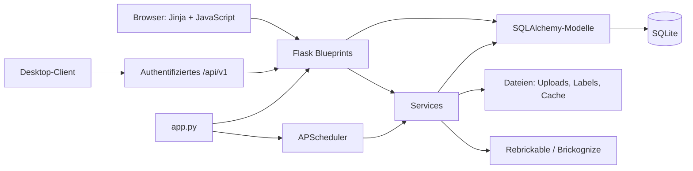

# Referenzarchitektur

## Zweck und Leitprinzipien

Brick Manager ist ein einzelner Flask-Prozess mit servergerendertem Web-UI, einer kleinen JSON-API für vertrauenswürdige Desktop-Clients und einer lokalen SQLite-Datenbank. Die Architektur bewahrt die Grenzen des gewachsenen Systems, statt eine zusätzliche abstrakte Schicht einzuführen.

1. Routen sind die HTTP-Grenze; sie validieren Eingaben, bestimmen Statuscodes und rendern HTML oder JSON.
2. Services kapseln wiederverwendbare Fach-, Integrations-, Datei-, Cache- und Renderinglogik.
3. Modelle definieren Persistenz, Beziehungen und einfache Serialisierung.
4. `app.py` ist der derzeitige Kompositionspunkt und hat bewusst dokumentierte Startseiteneffekte.
5. Rebrickable-Katalogdaten und sammlungseigene Daten bleiben getrennt.

## Systemübersicht

## Komponenten und Verantwortlichkeiten

| Bereich | Ort | Verantwortung |
| --- | --- | --- |
| App-Komposition | `brick_manager/app.py` | Flask-Erweiterungen, Logging, Blueprints, Startlogik und Scheduler |
| Konfiguration | `brick_manager/config.py` | Pfade, Umgebungsvariablen und Größenlimits |
| HTTP/UI | `brick_manager/routes/` | Blueprints, Eingabegrenzen, HTTP/JSON/Template-Verträge |
| Domäne/Integration | `brick_manager/services/` | Rebrickable, Brickognize, Labels, Caches, Imports und Backups |
| Persistenz | `brick_manager/models.py` | Tabellen, Beziehungen, Constraints und Serialisierung |
| Präsentation | `brick_manager/templates/`, `brick_manager/static/` | Jinja-Templates, CSS und Vanilla JavaScript |
| Tests | `brick_manager/tests/`, `tests/js/` | Flask-/SQLite-Verträge und isolierte JavaScript-Checks |

`app.py` registriert 17 Blueprints. Der Desktop-Client ist auf `/api/v1` beschränkt und verlangt einen Bearer-Key. Die UI-Routen sind nicht automatisch durch diesen Key geschützt; ein öffentliches Deployment braucht eine passende Netzwerk- und Zugriffsabsicherung.

## Persistenz und Ownership

Die vollständige Tabellenreferenz steht in [Datenbankschema](../reference/database-schema.md).

- Rebrickable-Tabellen sind ersetzbare Referenzkataloge.
- `user_sets`, `user_parts`, `user_minifigures`, `user_minifigure_parts`, `part_storage`, `collection_snapshots` und `config_settings` sind sammlungseigener Zustand.
- Ein Katalogimport darf Status, Mengen, Notizen, Lagerorte und Label-Status der Sammlung nicht löschen oder überschreiben.
- Schemaänderungen an bestehenden Datenbanken benötigen eine vorwärtsgerichtete und wiederholbar sichere Migration; `db.create_all()` genügt dafür nicht.

## Start- und Hintergrundverhalten

Beim Import von `app.py` werden Tabellen für neue Installationen angelegt, Lookup-Daten geladen, Blueprints registriert und ein Scheduler gestartet. Der Scheduler legt einen Backup-Job im Sechs-Stunden-Intervall sowie Jobs für fehlende Teile und Benutzer-Sets in Intervallen von sechs Stunden und 30 beziehungsweise 35 Minuten an. Deshalb importieren Routen- und Modelltests nicht die Produktiv-App, sondern verwenden `brick_manager/tests/conftest.py`.

Das ist Ist-Verhalten, keine Empfehlung für einen ungetesteten App-Factory-Umbau. Eine Änderung daran benötigt Charakterisierungstests und eine explizite Architekturentscheidung.

## Erweiterungsregeln

| Änderung | Platzierung und Nachweis |
| --- | --- |
| Neue HTML- oder JSON-Funktion | passender Blueprint; Erfolg, Eingabefehler und fehlende Ressource testen |
| Wiederverwendbare Fachlogik | Service; externe Aufrufe am `requests`-Rand mocken |
| Neues Persistenzfeld | Modell, vorwärtsgerichtete Migration, Schema-Referenz und Migrationstest |
| Externer Vertrag | Service plus Kontrakt- und Fehlerpfadtests; keine Live-Aufrufe im Test |
| Neue Konfiguration | `Config`, `.env.example` und Konfigurationsreferenz |

Öffentliche Routen, JSON-Felder, Statuscodes, Tabellen und Persistenzformate sind Verträge. Sie werden nur mit Kompatibilitätsanalyse, Tests und aktualisierter Dokumentation geändert.
